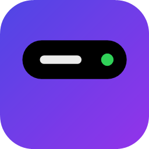
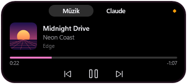
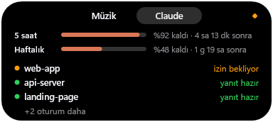
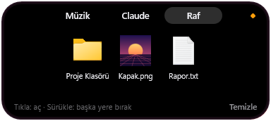
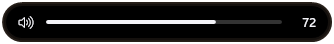

<p align="center">
  
</p>

<h1 align="center">Dynamic Island for Windows</h1>

<p align="center">
  A small pill at the top of your screen, like the iPhone's Dynamic Island: what's playing, your Claude Code sessions, notifications and volume, at a glance.
</p>

<p align="center">
  <a href="https://github.com/nightdevx/dynamic-island-windows/releases/latest"></a>
  
  
  <a href="LICENSE"></a>
</p>

<p align="center">
  <b>English</b> · <a href="README.tr.md">Türkçe</a>
</p>

<p align="center">
  
</p>
<p align="center">
  
  &nbsp;
  
</p>

## Features

- **Now playing:** any player that shows up in Windows' media controls (Spotify, browsers, Media Player, Apple Music…). Title, artist, cover art and progress. Previous, play/pause, next, shuffle and repeat buttons when the player supports them. Click the progress bar to seek. Click the cover or the title to bring the player to the front, right down to its browser tab. With several players open, switch between them from the open island or with the mouse wheel. A paused song stays on the closed island. While music plays, the closed island takes on the cover's colors, with a soft glow and a small equalizer that moves with how loud the music plays. A title too long for the closed island scrolls by once.
- **Liked songs:** tap the heart on the music page to keep the song in your list. Find them under Settings → Liked, where a click looks a song up on YouTube Music.
- **Claude Code:** open sessions and what they are doing (working, waiting for permission, answer ready), plus how much of your 5-hour and weekly plan limits you have used. Click a session to bring its window to the front. The 5-hour limit sits in the closed island's right end and moves out into a small bubble of its own when music starts; when a session needs you or finishes, the bubble grows to say so for a few seconds (10 by default, adjustable).
- **Notifications:** new Windows notifications show up on the island as a short preview with the app's logo. The island has its own Do not disturb, separate from Windows'.
- **File shelf:** drag files onto the island (or right-click them → Send to → Dynamic Island) and they wait on its shelf; later drag them from there to any folder, mail or chat. Your files stay where they are: the shelf only remembers them, and a drop copies.
- **Screenshots on the shelf:** every screenshot you take while the island runs (Win + PrtScn, the Snipping Tool) lands in the shelf's second list with a short peek, labelled by the time it was taken. Like the file shelf it is for now: older screenshots are not listed, and one you clear does not come back.
- **Pick several:** on both lists, click to select, then drag the whole selection out at once. Double-click opens a file; the wheel scrolls a long list.
- **Volume:** a short peek with the level whenever the system volume changes.
- **Clock:** with no song on, the closed island shows the time and the day.
- **Timer:** the Timer tab counts down the minutes you pick (1 to 45, or any with the mouse wheel). While it runs, the closed island shows the time left; at the end an alarm sounds and the island says so.
- **Bluetooth headphones:** when the sound moves to a Bluetooth headset, a card shows its name and, when Windows knows it, its battery.
- **Out of the way:** hides by itself in fullscreen apps and games, and stays above other windows otherwise.
- **Settings window:** every option in one place, light or dark with Windows, in Turkish or English.

<p align="center">
  
</p>
<p align="center">
  
</p>

## Light on your PC

The island is a native Rust app with no runtime or browser engine. Every animation runs in Windows' own compositor (DWM), and the app draws only when something it shows changes. When nothing changes it sleeps and uses next to no CPU; memory stays around 12 MB. The installer is 2 MB.

## Install

Download `DynamicIsland-Setup-<version>.exe` from [Releases](https://github.com/nightdevx/dynamic-island-windows/releases/latest) and run it. No administrator rights are needed; it installs for your user only. During setup you can choose:

- **Start with Windows**
- **Connect to Claude Code** (offered when Claude Code is installed): adds the island's hooks to `~/.claude/settings.json` so the Claude tab sees your sessions. Everything else in the file stays as it is, and a backup is saved next to it the first time. Uninstalling removes the hooks again.

The installer isn't code-signed yet, so Windows SmartScreen may warn you: choose **More info → Run anyway**.

Requires Windows 10 (1809) or Windows 11, 64-bit. The interface is in Turkish or English, following Windows' language; you can change it in the settings.

## Use

- Hover over the island, or click it, to open it. The tabs at the top switch between Music, Claude, Shelf and Timer; the gear on the right opens the settings.
- Scroll over the island to switch to another player.
- Drag files onto the island to put them on the shelf. On the shelf (Files, Screenshots), click items to select them, drag one to drop the selection anywhere (it then leaves the shelf), double-click to open. "Select all" selects all; "Remove" / "Clear" takes items off the list without deleting them.
- Right-click the island or its tray icon for: start with Windows, settings, liked songs, Do not disturb, quit.

### Settings

Open the settings window from the gear in the open island, the right-click menu, or by starting the app again. It writes `%APPDATA%\DynamicIsland\settings.ini`, which you can also edit by hand; changes apply as soon as the file is saved.

| Setting | Default | |
|---|---|---|
| `language` | `auto` | `auto` (Windows' language), `tr` or `en` |
| `expand_on_hover` | `true` | Open on hover; `false` opens only on click |
| `hover_delay_ms` | `300` | How long to hover before it opens (ms) |
| `hide_exe` | empty | Hide while these programs are in front, e.g. `valorant.exe, obs64.exe` |
| `show_exe` | empty | Stay visible even when these go fullscreen |
| `equalizer` | `true` | Moving equalizer bars while music plays |
| `glow` | `true` | A soft glow in the cover's color while music plays |
| `song_peek` | `true` | Show a new song for a moment when it starts |
| `volume_peek` | `true` | Show the level when the system volume changes |
| `bluetooth_peek` | `true` | A card with a Bluetooth headset's name and battery when it connects |
| `claude_peek` | `true` | The bubble grows when a Claude session needs you or finishes |
| `claude_news_seconds` | `10` | How long the bubble stays grown (seconds) |
| `notifications` | `true` | Show new notifications in a short preview |
| `do_not_disturb` | `false` | The island opens by itself for nothing |
| `screenshots` | `true` | New screenshots go to the shelf, with a peek |

### Claude Code by hand

If you skipped the setup option, add this to `~/.claude/settings.json` (replace `<user>` with your Windows user name):

<details>
<summary>hooks</summary>

```json
{
  "hooks": {
    "SessionStart":      [{ "hooks": [{ "type": "command", "command": "C:/Users/<user>/AppData/Local/DynamicIsland/island.exe", "args": ["--hook"], "timeout": 5 }] }],
    "UserPromptSubmit":  [{ "hooks": [{ "type": "command", "command": "C:/Users/<user>/AppData/Local/DynamicIsland/island.exe", "args": ["--hook"], "async": true }] }],
    "PostToolUse":       [{ "hooks": [{ "type": "command", "command": "C:/Users/<user>/AppData/Local/DynamicIsland/island.exe", "args": ["--hook"], "async": true }] }],
    "PermissionRequest": [{ "hooks": [{ "type": "command", "command": "C:/Users/<user>/AppData/Local/DynamicIsland/island.exe", "args": ["--hook"], "async": true }] }],
    "Notification":      [{ "matcher": "permission_prompt", "hooks": [{ "type": "command", "command": "C:/Users/<user>/AppData/Local/DynamicIsland/island.exe", "args": ["--hook"], "async": true }] }],
    "Stop":              [{ "hooks": [{ "type": "command", "command": "C:/Users/<user>/AppData/Local/DynamicIsland/island.exe", "args": ["--hook"], "async": true }] }],
    "SessionEnd":        [{ "hooks": [{ "type": "command", "command": "C:/Users/<user>/AppData/Local/DynamicIsland/island.exe", "args": ["--hook"], "timeout": 5 }] }]
  }
}
```

</details>

Or run `island.exe --setup-claude`, which does the same as the installer option (`--remove-claude` undoes it).

## Privacy

Nothing leaves your PC except one request: to show your plan limits, the island reads the sign-in Claude Code saved (`~/.claude/.credentials.json`) and asks Anthropic's API for your usage. The token goes only to `api.anthropic.com` over HTTPS, is never stored or logged, and is used at most every 3 minutes, only while you use Claude.

Notifications are read on your PC through Windows' notification access and are not kept. If none show up, check that notification access is allowed in Windows Settings → Privacy & security → Notifications. Liked songs are saved in `%APPDATA%\DynamicIsland\liked.tsv`; a song is looked up on YouTube Music only when you click it.

## Uninstall

Settings → Apps → Dynamic Island → Uninstall. The app, its logs, the autostart entry and the Claude Code hooks are removed; your settings and liked songs stay.

## Build from source

You need Rust (stable, MSVC toolchain) and, for the installer, [Inno Setup 6](https://jrsoftware.org/isinfo.php).

```powershell
cargo build --release                      # island.exe
cargo test
powershell -File scripts\package.ps1       # installer: dist\DynamicIsland-Setup-<version>.exe
powershell -File scripts\make-icon.ps1     # redraws assets\island.ico
```

How it is put together:

| | |
|---|---|
| `src/window.rs` | The window, its messages and what happens on each event |
| `src/island.rs`, `src/blur.rs` | The composition tree: springs, blurs, every visual |
| `src/pages.rs`, `src/render.rs` | What gets drawn (Direct2D/DirectWrite) |
| `src/media.rs`, `src/player.rs` | Windows media sessions on their own thread; bringing a player to the front |
| `src/timer.rs`, `src/bluetooth.rs` | The timer; which Bluetooth headset plays |
| `src/liked.rs` | Liked songs |
| `src/notices.rs` | Windows notifications |
| `src/preferences.rs`, `src/settings.rs`, `src/text.rs` | The settings window, the settings file, Turkish and English texts |
| `src/claude.rs`, `src/usage.rs` | Claude Code hooks, sessions and plan limits |
| `src/audio.rs` | The system volume |
| `src/shelf.rs` | The file shelf: drag and drop in and out |
| `src/json.rs` | Editing Claude Code's settings without reordering them |
| `src/fullscreen.rs` | When to hide |

## Contact

nightdijital · [nightdijital.com](https://nightdijital.com) · [iletisim@nightdijital.com](mailto:iletisim@nightdijital.com)

Released under the [MIT license](LICENSE).
